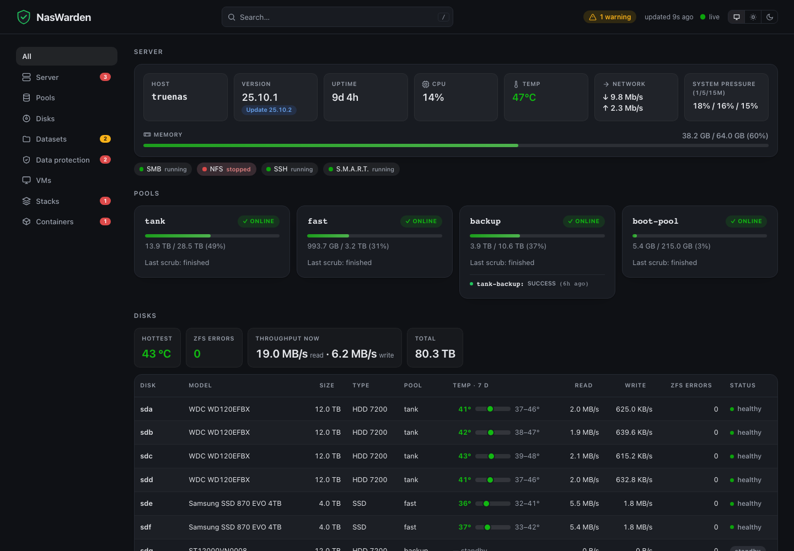
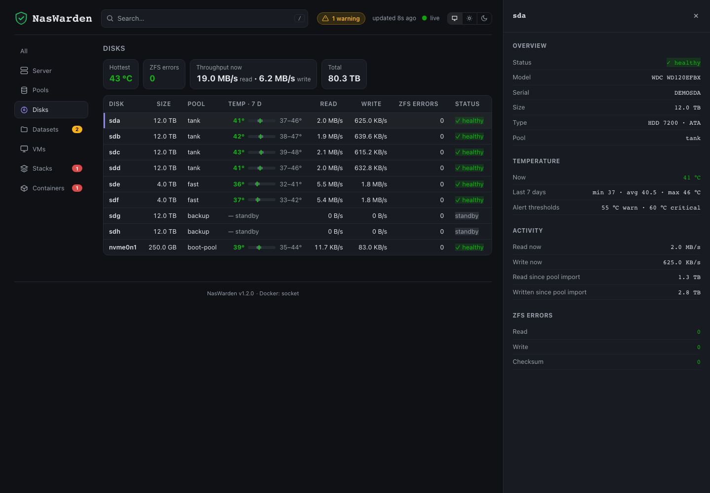
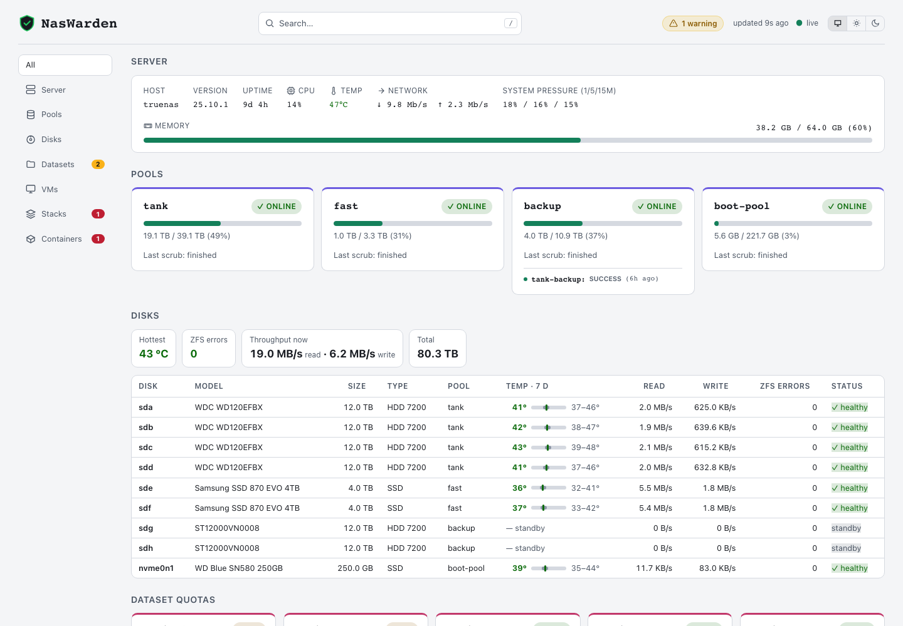
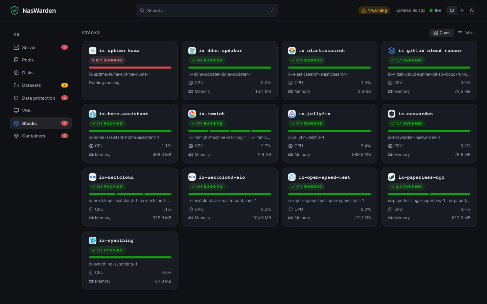

# NasWarden

A fast, glanceable, real-time monitoring dashboard and telemetry exporter for **TrueNAS SCALE** homelabs.

**NasWarden** was built to fill a critical gap: standard monitoring tools (`df`, `node-exporter`) only track per-*mountpoint* disk usage and are completely blind to **ZFS dataset-level quota and refquota limits**. On TrueNAS systems where app data, backups, and user home directories are capped using dataset properties, exhaustion happens silently without mountpoint-level alerts.

NasWarden monitors dataset quota utilization in real time, and expands into a unified, single-page operational board covering the entire host:
- **ZFS Dataset Quotas & Storage Pools**
- **Hardware Telemetry & Host Pressure**
- **Docker Compose Stacks & Container Health**
- **Virtual Machines & Containers (TrueNAS Native KVM + Incus KVM/LXC)**
- **Prometheus Metrics & PromQL Linear Exhaustion Forecasting**

## Screenshots

Demo data, not a real system: a made-up TrueNAS with catalog apps ([`web/scripts/demo-state.mjs`](web/scripts/demo-state.mjs)). To take them again, run `npm run screenshots` in `web/` (once before: `npx playwright install --only-shell chromium`).





Light theme (follows the system by default; the switch in the top bar picks System, Light or Dark):





---

## Key Features

### 1. ZFS Quota Utilization & Pool Health
- **Dataset Quota Tracking**: Discovers all datasets with `quota` or `refquota` configured. Displays live space consumed vs. limit, quota source, compression algorithm, ratio, record size, and space held by snapshots.
- **Visual Thresholds**: Color-coded utilization bars (green `< 70%`, yellow `70%–89%`, red `≥ 90%`).
- **Usable Capacity**: The pool card shows the space files can actually use (the root dataset's used + available, as in `zfs list`), not the zpool's raw size, which counts RAIDZ parity and the ZFS reserve. The raw size stays in the pool's detail panel.
- **Pool Topology & Scans**: Tracks pool status (`ONLINE`, `DEGRADED`, `FAULTED`), vdev topology (mirrors, bare disks, stripes), per-disk read/write/checksum errors, fragmentation, and scrub/resilver progress.

### 2. Host Resources & ZFS ARC Breakdown
- **Hardware Telemetry**: System pressure (normalized CPU load), package CPU temperature, and physical vs. logical core counts.
- **ZFS ARC Cache Separation**: Splits ZFS Adaptive Replacement Cache (ARC) out from regular memory usage so reclaimable filesystem cache isn't mistaken for runaway application memory.
- **Active Network Interfaces**: Live link status, connection speeds, and IP addresses.

### 2b. Disks & Network
- **Disks tab**: every physical drive with model, capacity, type, pool, current temperature with its 7-day range, live read/write rate (from ZFS counters, pool members) and ZFS error counts. Click a disk for details. Temperature turns amber at 55 °C and red at 60 °C, matching the shipped alert rules.
- **Updates**: a badge on the Server card when TrueNAS has a newer version (release notes link in the Server panel), and how many catalog apps have a newer version of their software (updates that only change the catalog packaging are not counted). Checked at start and every 6 hours, never on each refresh; hidden when TrueNAS cannot reach its update server. NasWarden only shows it and never starts an update. Works with the Readonly Admin role.
- **Network**: total live throughput on the Server card, and per-interface received/sent rates (plus link utilisation for physical interfaces) in the Server panel.
- SMART health is not shown: TrueNAS 25.10 removed SMART from its API.

### 3. Docker Compose Stacks
- **Project Aggregation**: Automatically groups containers by their Docker Compose project (`com.docker.compose.project`), reporting aggregate CPU/memory and member health (e.g. `4/4 running`).
- **Graceful Stops vs. Crashes**: Distinguishes intentional exits (`exit 0`, `SIGTERM 143`, `SIGKILL 137`) from abnormal crashes (error exit codes, kernel `OOMKilled`), keeping clean stops from triggering false positive health alerts.
- **Container Details**: Bind mounts vs. named volumes, network IP addresses, published ports, restart policies, and commands.
- **Customization Labels**:
  - `naswarden.icon`: Override or specify the icon slug (e.g. `jellyfin`, `postgres`, `caddy`).
  - `naswarden.optional`: Mark non-critical or batch services to exclude from stack health degradation counts.

### 4. Unified Virtual Machines & Containers (KVM + LXC)
- **TrueNAS Native VMs**: Connects to TrueNAS middleware to monitor native KVM VMs (e.g. Windows VMs with PCI passthrough). Discovers guest OS, CPU socket/core topology, ZFS zvol backing storage, SPICE display/web ports, and hardware passthrough devices (e.g. NVIDIA GeForce GPUs).
- **Incus (LXD) Integration**: Connects via mTLS to monitor Incus virtual machines and system containers. Reports vCPU counts, memory limits, guest IP addresses, network bridges, and boot autostart.
- **4-Tier Icon Pipeline**: Automatically resolves icons from user overrides (`user.icon` / `naswarden.icon`), workload names (`k8s-*`, `gitlab-*`, `openstack`), guest OS (`windows`, `ubuntu`, `debian`, `arch`, `alpine`), or platform fallbacks.

### 5. Glanceable UI & Accessibility
- **Responsive Layout**: Sticky left-nav rail with live alert counters for quick section jumping (`All`, `Server`, `Pools`, `Datasets`, `VMs`, `Stacks`, `Containers`), collapsing smoothly on mobile.
- **Slide-In Detail Drawers**: Deep dive into hardware, vdevs, storage mountpoints, network interfaces, and container mounts without leaving the page. Fully keyboard accessible (`Escape` to close, `Tab` focus trap, focus restoration).
- **Light and dark themes**: follows the system by default; a System / Light / Dark switch in the top bar overrides it and is remembered in the browser. The theme is set before the first paint, so there is no flash.
- **Global Search Filter**: Fast search box (`/` shortcut) filtering pools, datasets, stacks, and virtual machines simultaneously.

---

## Zero-Mutation Read-Only Architecture

**NasWarden** is strictly a read-only telemetry dashboard. It never changes the host, starts or stops containers, or alters datasets. What it could do if it were compromised depends on the access you give it:
- **TrueNAS API**: Connects over WebSocket (`wss://`) with an API key and sends only read queries (`pool.query`, `pool.dataset.query`, `disk.details`, `vm.query`, `alert.list`, `system.info` and similar). What the key itself may do is up to you: see [Security notes](#security-notes).
- **Docker Isolation**: NasWarden only sends GET requests to Docker. The recommended setup puts a read-only [`tecnativa/docker-socket-proxy`](https://github.com/Tecnativa/docker-socket-proxy) in between, scoped strictly to `CONTAINERS=1`, so all mutating POST, PUT, and DELETE calls are also blocked at the proxy. Mounting the socket into NasWarden directly also works, but then nothing but NasWarden's own code keeps it read-only.
- **Incus API**: Communicates via mTLS REST API (`GET /1.0/instances?recursion=2`).

---

## Setup

NasWarden needs one credential (a TrueNAS API key) and can use two optional ones (Docker access and an Incus client certificate).

| Access | What it needs | Can it be read-only? |
|---|---|---|
| TrueNAS API (required) | An API key of a user with the **Readonly Admin** role | Yes |
| Docker stacks and containers (optional) | The read-only socket proxy, or the Docker socket; no key | With the proxy: listing and inspecting only. With the socket: no |
| Incus VMs and containers (optional) | A client certificate trusted by Incus | No: with Incus 6.0 a certificate is not read-only (see below) |

### 1. TrueNAS API key (required)

1. **Credentials → Users → Add.** Give it a name such as `naswarden`, set **Roles** to **Readonly Admin**, and leave shell access and sudo off. You never log in as this user.
2. **Credentials → Users**, open that user, then **Access → View API Keys**, and **Add** a key (TrueNAS 25.x). Name it `naswarden`, check that **Username** is that user, choose an expiry (or non-expiring), and save.
3. **Copy the key when it is shown.** TrueNAS shows it once. Put it in `TRUENAS_API_KEY`.
4. Set `TRUENAS_HOST` to the address of the TrueNAS web interface, `host:port`, for example `truenas.local:443`. Set `TRUENAS_TLS=true`, and `TRUENAS_INSECURE_TLS=true` only if TrueNAS uses its self-signed certificate.

The key takes the rights of its user. The Readonly Admin role is enough for everything NasWarden asks TrueNAS for; a Full Admin key works too but can change anything, so avoid it.

### 2. Docker stacks and containers (optional)

Give NasWarden access to the Docker API in one of two ways. No key is involved either way. Without either, the Stacks and Containers sections are simply absent.

- **Recommended, a read-only proxy:** run a [`tecnativa/docker-socket-proxy`](https://github.com/Tecnativa/docker-socket-proxy) next to NasWarden with `CONTAINERS=1`, mount the Docker socket into the proxy only, and set `DOCKER_PROXY_URL=http://<proxy>:2375` (or, in Docker's own form, `DOCKER_HOST=tcp://<proxy>:2375`). See [Deployment](#deployment) for a complete example.

  In the TrueNAS catalog app, with a proxy you run yourself (for example as its own compose stack): open the app and choose **Edit**, add the proxy's Docker network under **Network Configuration → Networks** with the **naswarden** container, and add `DOCKER_PROXY_URL` = `http://<proxy container name>:2375` under **Additional Environment Variables**.
- **Or the Docker socket itself:** mount `/var/run/docker.sock` into NasWarden and run NasWarden with the socket's group (`docker`, usually gid 999). NasWarden finds a socket mounted at that path on its own, like Docker's own CLI does; set `DOCKER_HOST=unix:///<path>` only if you mount it somewhere else. Simpler, but mounting the socket read-only does not make Docker read-only: whatever can reach the socket can control Docker. NasWarden only sends GET requests, but nothing enforces that. If the group is wrong, the log says so at startup. If a socket exists at that path but nothing is listening on it (for example Docker is not running on your own machine), NasWarden logs a warning and runs without container stats; the same dead socket named in `DOCKER_HOST` is an error.

  In the TrueNAS catalog app, open the app and choose **Edit**:
  1. **User and Group Configuration → Group:** `999`.
  2. **Storage → Additional Storage → Add:** type **Host Path**, host path `/var/run/docker.sock`, mount path `/var/run/docker.sock`, **Read Only** on.

### 3. Incus (optional)

Incus is only reachable with a client certificate, and TrueNAS's web interface has no page for Incus client certificates or for the Incus network listener, so this step is done from a shell on the TrueNAS host (as an administrator).

1. **Make a certificate** on any machine:
   ```sh
   openssl req -x509 -newkey ec -pkeyopt ec_paramgen_curve:secp384r1 -sha384 \
     -keyout client.key -out client.crt -nodes -days 3650 -subj "/CN=naswarden"
   ```
2. **Trust it in Incus** on the TrueNAS host:
   ```sh
   incus config trust add-certificate client.crt --name naswarden
   ```
   Instances created in the TrueNAS web interface all live in Incus's `default` project, so nothing more is needed. If you have made your own Incus projects from the shell, you know which ones NasWarden should see: add `--restricted --projects <name,...>` to limit the certificate to them.
3. **Check that Incus listens on the network:** `incus config get core.https_address` should print something like `:8444`. If it is empty, `incus config set core.https_address :8444`.
4. **Configure NasWarden:** `INCUS_URL=https://<truenas-host>:8444`, and `INCUS_CLIENT_CERT` / `INCUS_CLIENT_KEY` set to the contents of `client.crt` and `client.key` (PEM text, base64, or a file path inside the container). `INCUS_INSECURE_TLS=true` accepts Incus's self-signed server certificate.

NasWarden only sends `GET /1.0/instances?recursion=2`, but with Incus 6.0 a trusted certificate is not read-only: it can manage instances (start, stop, delete). Treat the private key like a password, and leave Incus unset if you do not need it. Incus releases that support fine-grained permissions (`incus auth`) can grant a viewer-only identity.

---

## Security notes

- **Use a read-only API key.** A TrueNAS API key has the rights of the user it belongs to. NasWarden only reads, but a key from an administrator account could change anything if it leaked. Create a dedicated user (Credentials → Users → Add) with the **Readonly Admin** role, then add the key for that user (on that user's Access → View API Keys). That role covers every call NasWarden makes.
- **DNS rebinding (opt-in protection).** A web page on the internet can try to reach a dashboard on your LAN by pointing its own domain at your NAS's address. Set `NASWARDEN_ALLOWED_HOSTS` to the host names you use (for example `naswarden.home.example`) and NasWarden refuses, with `421 Misdirected Request`, any request for another name, except IP addresses, `localhost` and single-word names like `nas`. It is off by default so upgrading never locks you out; while it is unset, NasWarden logs each unknown host name once. Without a login this is the only protection against it.
- **The dashboard has no login.** Anyone who can reach the port sees your pools, disks and containers. Keep it on your LAN, or put it behind an authenticating reverse proxy or access gateway. Do not expose it to the internet as is.
- **Docker access is limited, not zero.** The socket proxy only allows listing and inspecting containers. An inspect response includes each container's environment variables; NasWarden does not read or show them, but the proxy would return them to a compromised NasWarden. With the socket mounted directly (no proxy), nothing limits that access at all. If you do not want Docker in the dashboard, set neither variable and do not mount the socket into NasWarden.
- **Incus certificates are not read-only** (Incus 6.0). See [Setup](#3-incus-optional).
- **Certificates.** `TRUENAS_INSECURE_TLS=true` skips certificate checks, which is common with TrueNAS's self-signed certificate on a trusted LAN. With a certificate your clients trust, leave it off.

---

## Prometheus Metrics & PromQL Alerts

NasWarden exposes Prometheus gauges at `/metrics` for integration with Prometheus, Alertmanager, or Grafana:

| Metric | Type | Description |
|---|---|---|
| `naswarden_dataset_quota_used_bytes{dataset}` | Gauge | Bytes used on a ZFS dataset with a quota |
| `naswarden_dataset_quota_bytes{dataset}` | Gauge | Configured quota/refquota limit in bytes |
| `naswarden_pool_allocated_bytes{pool}` | Gauge | Allocated storage space in bytes |
| `naswarden_pool_size_bytes{pool}` | Gauge | Raw zpool size in bytes (includes RAIDZ parity and the ZFS reserve) |
| `naswarden_pool_usable_bytes{pool}` | Gauge | Usable capacity in bytes: used plus available of the pool's root dataset, what `zfs list` shows. Absent for a pool whose root dataset could not be read |
| `naswarden_pool_available_bytes{pool}` | Gauge | Bytes still available for files in the pool (root dataset). Absent like the one above |
| `naswarden_pool_healthy{pool}` | Gauge | `1` if pool is ONLINE and healthy, `0` if degraded/faulted |
| `naswarden_instance_up{instance, manager, type}` | Gauge | `1` if VM or LXC container is running, `0` otherwise |
| `naswarden_container_up{container, stack}` | Gauge | `1` if Docker container is running, `0` otherwise |
| `naswarden_truenas_alert_count{level}` | Gauge | Active, un-dismissed TrueNAS alerts by severity |
| `naswarden_disk_temperature_celsius{pool, disk}` | Gauge | Current drive temperature (active drives only) |
| `naswarden_disk_errors{pool, disk, type}` | Gauge | ZFS read / write / checksum error count of a pool member disk since its pool was imported |
| `naswarden_disk_read_bytes_per_second{pool, disk}` | Gauge | Read rate of a pool member disk between refreshes. Absent until two refreshes have seen the disk |
| `naswarden_disk_write_bytes_per_second{pool, disk}` | Gauge | Write rate, like the one above |
| `naswarden_pool_fragmentation_percent{pool}` | Gauge | Free-space fragmentation of the pool. Absent when TrueNAS reports none |
| `naswarden_pool_scan_in_progress{pool, function}` | Gauge | `1` while the pool's latest scan (`scrub` or `resilver`) is running, `0` otherwise |
| `naswarden_pool_scan_progress_percent{pool, function}` | Gauge | Progress of the running scan. Only present while one runs and TrueNAS reports it |
| `naswarden_pool_last_scrub_timestamp_seconds{pool}` | Gauge | Unix time the last scrub finished. Only present while the pool's latest scan is a finished scrub (a later resilver replaces it) |
| `naswarden_dataset_snapshot_bytes{dataset}` | Gauge | Bytes held only by snapshots, for datasets with a quota |
| `naswarden_dataset_compression_ratio{dataset}` | Gauge | Compression ratio (`1.5` = 1.5x), for datasets with a quota |
| `naswarden_truenas_info{version}` | Gauge | Always `1`; the label is the TrueNAS version |
| `naswarden_replication_task_status{task_id, name, target_pool, state, job_state}` | Gauge | `1` for a task's current state |
| `naswarden_replication_last_success_timestamp_seconds{name}` | Gauge | Unix time the task last finished successfully (remembered across failed runs) |
| `naswarden_service_up{service}` | Gauge | `1` if the TrueNAS service (`cifs`, `nfs`, `ssh`, ...) is running, `0` if not; only services that are enabled or running |
| `naswarden_last_refresh_success_timestamp_seconds` | Gauge | Unix time of the last successful refresh of the core TrueNAS data |
| `naswarden_source_stale{source}` | Gauge | `1` if that source (`docker`, `truenas-vms`, `incus`, `disks`, `alerts`, `replication`, `services`, `shares`) failed its last refresh and its previous data is being served |

### Alerting Rules Examples

#### 1. Predictive Quota Exhaustion (7-Day Forecast)
Using PromQL's `predict_linear()` over raw byte counts to alert before a dataset runs out of space based on the last 4 hours of growth:
```promql
predict_linear(naswarden_dataset_quota_used_bytes[4h], 86400 * 7) > naswarden_dataset_quota_bytes
```

#### 2. High Quota Utilization (> 90%)
```promql
(naswarden_dataset_quota_used_bytes / naswarden_dataset_quota_bytes) >= 0.90
```

#### 3. Storage Pool Degradation
```promql
naswarden_pool_healthy == 0
```

#### 4. Critical Service Down
```promql
naswarden_container_up{stack="media", container="jellyfin"} == 0
```

#### 5. Ready-made rules

`deploy/prometheus/naswarden.rules.yml` contains 10 rules covering NasWarden itself (refresh stale for 3 min, a source not updating for 5 min, not scraped), TrueNAS (critical alerts, unresolved warnings, degraded pool, disk over 55 C / 60 C) and replication (task failed, no success for 26 h). Add it to `rule_files` and adjust thresholds to taste. Validate with `promtool check rules deploy/prometheus/naswarden.rules.yml`.

#### 6. Grafana dashboard

`deploy/grafana/naswarden.dashboard.json` is a ready-made dashboard (uid `naswarden-overview`, 21 panels): health at a glance, pool and dataset usage, capacity trends, disk temperatures, TrueNAS alerts, replication status, containers that are down and per-source freshness. It uses a `datasource` variable, so it works with any Prometheus datasource that scrapes NasWarden.

Import it in the UI (**Dashboards -> New -> Import**, then pick your Prometheus datasource), or through the API:

```sh
# TOKEN: a Grafana service-account token with the Editor role
jq '{dashboard: (. + {id: null}), overwrite: false}' deploy/grafana/naswarden.dashboard.json |
  curl -s -X POST -H "Authorization: Bearer $TOKEN" -H 'Content-Type: application/json' \
    --data @- http://grafana:3000/api/dashboards/db
```

Importing adds a new dashboard; it never touches existing ones unless you re-import the same uid with `overwrite: true`.

---

## Configuration

All configuration is provided via environment variables:

| Env Var | Required | Default | Description |
|---|---|---|---|
| `TRUENAS_HOST` | **Yes** | — | TrueNAS host and port, e.g. `truenas.local:8443`, without `https://`. An address copied from the browser (`https://truenas.local:8443/`) is accepted: NasWarden drops the scheme with a warning, and uses TLS if `TRUENAS_TLS` is not set |
| `TRUENAS_API_KEY` | **Yes** | — | API key generated in TrueNAS (Credentials → Users → the user → Access → View API Keys, 25.x); see [Setup](#setup) |
| `TRUENAS_TLS` | No | `false` | Set `true` to connect over `wss://` |
| `TRUENAS_INSECURE_TLS` | No | `false` | Set `true` to skip certificate validation (e.g. self-signed TrueNAS certs) |
| `DOCKER_PROXY_URL` | No | — | Read-only Docker socket proxy for stacks and containers, e.g. `http://docker-proxy:2375`. Proxies only (`http://`, `https://`, `tcp://`); for the socket use `DOCKER_HOST`. Takes precedence over `DOCKER_HOST` |
| `DOCKER_HOST` | No | `unix:///var/run/docker.sock` if a socket is mounted there | Docker API in Docker's own form: a socket mounted elsewhere, `unix:///<path>`, or a proxy, `tcp://docker-proxy:2375`. Ignored when `DOCKER_PROXY_URL` is set |
| `INCUS_URL` | No | — | Incus server API URL, e.g. `https://truenas.local:8444` |
| `INCUS_CLIENT_CERT` | No | — | Incus client certificate (PEM string, base64, or file path) |
| `INCUS_CLIENT_KEY` | No | — | Incus client private key (PEM string, base64, or file path) |
| `INCUS_INSECURE_TLS` | No | `true` | Set `false` to enforce Incus server TLS certificate validation |
| `PORT` | No | `8080` | HTTP port for the web UI and `/metrics` endpoint |
| `NASWARDEN_ALLOWED_HOSTS` | No | — | Turns on refusing requests for unknown host names (DNS rebinding protection). Comma-separated host names NasWarden answers to, besides IP addresses, `localhost` and single-word names like `nas`, e.g. `naswarden.home.example` for a reverse proxy. Other hosts get `421 Misdirected Request`. Unset: nothing is refused, and unknown hosts are logged once as a warning. `*` silences the warning. See [Security notes](#security-notes) |

---

## Deployment

### Docker Compose with Read-Only Socket Proxy

```yaml
services:
  naswarden:
    image: ghcr.io/ahmd-soliman/naswarden:latest
    container_name: naswarden
    restart: unless-stopped
    ports:
      - "8080:8080"
    environment:
      - TRUENAS_HOST=truenas.local:8443
      - TRUENAS_API_KEY=${TRUENAS_API_KEY}
      - TRUENAS_TLS=true
      - TRUENAS_INSECURE_TLS=true
      - DOCKER_PROXY_URL=http://docker-proxy:2375
      - INCUS_URL=https://truenas.local:8444
      - INCUS_CLIENT_CERT=${INCUS_CLIENT_CERT}
      - INCUS_CLIENT_KEY=${INCUS_CLIENT_KEY}
      - INCUS_INSECURE_TLS=true
    depends_on:
      docker-proxy:
        condition: service_healthy

  # Scoped read-only proxy: blocks all write/mutating API requests
  docker-proxy:
    image: ghcr.io/tecnativa/docker-socket-proxy:v0.5.0
    container_name: naswarden-docker-proxy
    restart: unless-stopped
    environment:
      - CONTAINERS=1 # Allow read access to list, inspect, and stats
    volumes:
      - /var/run/docker.sock:/var/run/docker.sock:ro
    healthcheck:
      test: ["CMD", "wget", "-qO-", "http://127.0.0.1:2375/version"]
      interval: 10s
      timeout: 5s
      retries: 3
```

### Resilience

- **Reconnects on its own** if the TrueNAS websocket drops (reboot, network blip); no container restart needed.
- **A failing source keeps its last good data.** If Docker, Incus or the TrueNAS VM query fails, its cards and metrics stay at the previous snapshot instead of vanishing, and the header shows `partial` naming the source.
- **`/healthz`** returns `503` once no refresh has succeeded for three intervals (3 minutes), so a container healthcheck notices a lost TrueNAS.
- **`/ws` is same-origin only.** A browser page served from a different host than the one it connects to is refused. Behind a reverse proxy, keep the original `Host` header (Caddy and nginx `proxy_set_header Host $host` do).

---

## Development

```bash
# Run backend
export TRUENAS_HOST="truenas.local:8443"
export TRUENAS_API_KEY="your-api-key"
export TRUENAS_TLS=true
export TRUENAS_INSECURE_TLS=true
go run ./cmd/naswarden

# Or build, run against your TrueNAS and check it end to end (keys come from the
# environment only; use a Readonly Admin user's key). KEEP=1 leaves it running.
scripts/local-test.sh

# Build frontend
cd web
npm install
npm run build

# Tests (CI runs all of these and checks the committed internal/web/dist is current)
golangci-lint run ./...   # config in .golangci.yml
go test -race ./...
npm run lint
npm test
```

## License

MIT. See [LICENSE](LICENSE).
